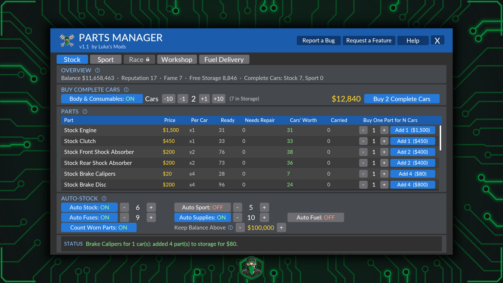

  

<h1 align="center">Luka's Mods</h1>

Mods that cut the busywork, so you can get back to the game.

---

## Car Dealer Simulator

### Parts Manager

  

**Skip the Hundred Clicks.** Parts Manager is an app on your tablet and your office computer.

- **Any Part, by the Car:** one click buys a whole car's worth of a part. Four brake calipers, one click.
- **Buy a Whole Car at Once:** every part of a kit in one click, plus body parts and consumables if you want them.
- **Workshop Supplies:** soap, wax, polish, grinder discs, putty, oscillating polisher pads and paint for the car wash and body shop, 10 at a time.
- **Fuel Delivery:** fills your Gas Pump Hub's tanks at the gas station's price. Skips the drive, not the cost. Needs the Gas Pump Hub upgrade and your own mobile fuel tank.
- **Auto-Stock:** keeps Stock, Sport and Race kits topped up in storage while you play, plus fuses and workshop supplies, and refills your hub's tanks when they run low. It never spends below the balance you set.
- **See Your Stock:** how many complete cars your storage can already build.
- **A Normal Purchase:** normal store prices, paid from your balance, straight into your warehouse storage. No delivery truck.

**[Download on Nexus Mods](https://www.nexusmods.com/cardealersimulator/mods/54)** · **[Full Guide](guides/car-dealer-simulator/parts-manager.md)** · **[Release 1.1](../../releases/tag/CDS-PartsManager-1.1)**

Needs the game's "Workshop Upgrades & Sprint Racing" update (October 2026) or later, and an **EXPERIMENTAL** build of UE4SS: [the one on Nexus Mods](https://www.nexusmods.com/cardealersimulator/mods/53) is tested. The "Up 2 You" DLC is optional, for the Sport and Race kits.

---

## Found a Problem, or Have an Idea?

Use the **Report a Bug** or **Request a Feature** button in the mod's in-game app. Or open an [issue](../../issues/new/choose) here using the bug report or feature request form.

---

[Permissions](PERMISSIONS.md): all rights reserved. You're welcome to download, install and play these mods.
