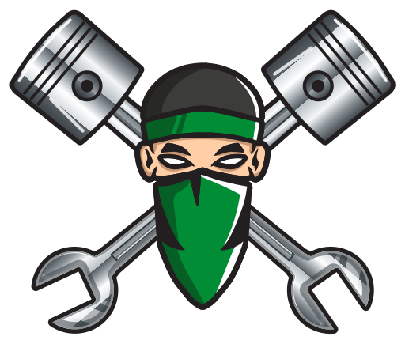
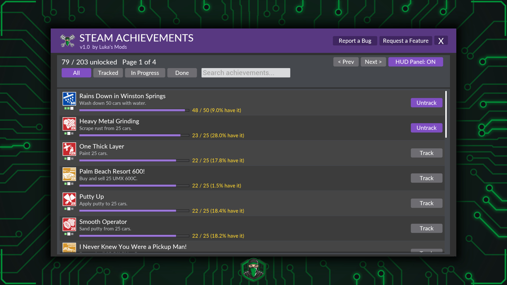
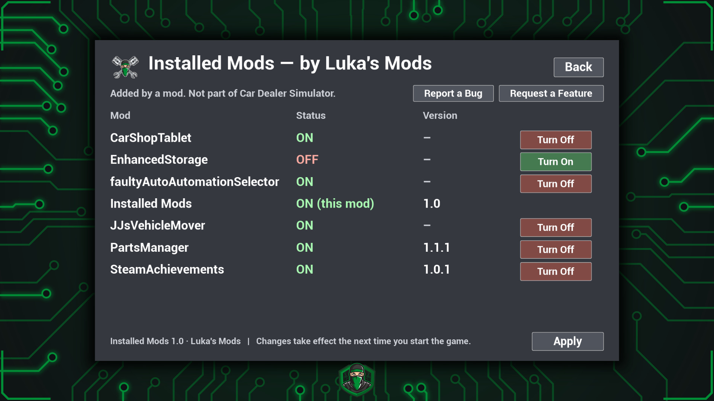
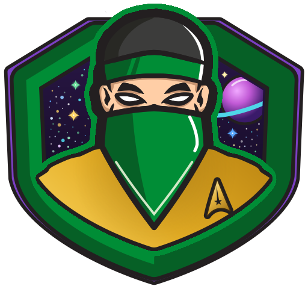
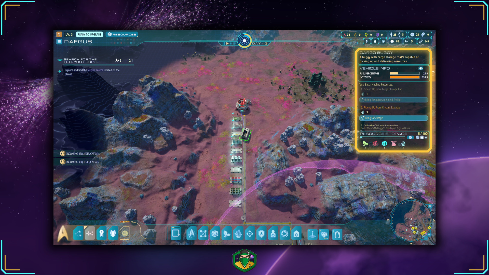
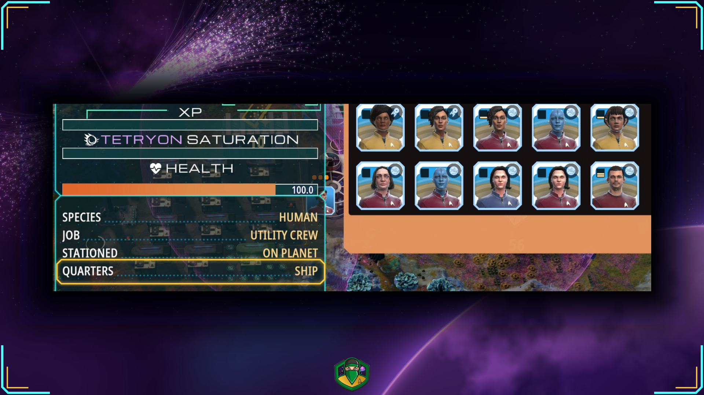

  

<h1 align="center">Luka's Mods</h1>

Mods that cut the busywork, so you can get back to the game.

---

  

<h2 align="center">Car Dealer Simulator</h2>

### Parts Manager

  

**Skip the Hundred Clicks.** Parts Manager is an app on your tablet and your office computer.

- **Any Part, by the Car:** one click buys a whole car's worth of a part. Four brake calipers, one click.
- **Buy a Whole Car at Once:** every part of a kit in one click, plus body parts and consumables if you want them.
- **Workshop Supplies:** soap, wax, polish, grinder discs, putty, oscillating polisher pads and paint for the car wash and body shop, 10 at a time, in whichever of the game's tiers you pick.
- **Fuel Delivery:** fills your Gas Pump Hub's tanks at the gas station's price. Skips the drive, not the cost. Needs the Gas Pump Hub upgrade and your own mobile fuel tank.
- **Auto-Stock:** keeps Stock, Sport and Race kits topped up in storage while you play, plus fuses and workshop supplies, and refills your hub's tanks when they run low. It never spends below the balance you set.
- **See Your Stock:** how many complete cars your storage can already build.
- **A Normal Purchase:** normal store prices, paid from your balance, straight into your warehouse storage. No delivery truck.

**[Download on Nexus Mods](https://www.nexusmods.com/cardealersimulator/mods/54)** · **[Full Guide](guides/car-dealer-simulator/parts-manager.md)** · **[Release 1.1.1](../../releases/tag/CDS-PartsManager-1.1.1)**

Needs the game's "Workshop Upgrades & Sprint Racing" update (October 2026) or later, and an **EXPERIMENTAL** build of UE4SS: [the one on Nexus Mods](https://www.nexusmods.com/cardealersimulator/mods/53) is tested. The newer supply tiers come with the game's "New Materials & Manager Features" update. The "Up 2 You" DLC is optional, for the Sport and Race kits.

---

### Steam Achievements

  

**Track as You Play.** Steam Achievements is an app on your tablet and your office computer, plus a small panel on your screen.

- **Every Achievement in One List:** all 203, with icon, description, progress bar and how many Steam players have each one.
- **Tiers at a Glance:** tiered achievements share one row, with a square for each tier.
- **Filter and Search:** All, Tracked, In Progress and Done, plus a search box.
- **Track Up to 4:** pin them to a small panel at the top right of your screen. With nothing tracked, it suggests the 4 easiest.
- **Live Progress:** wash a car and the count moves on the spot.
- **No Spoilers:** hidden achievements stay hidden until you unlock them.
- **Reads Only:** it never unlocks anything.

**[Download on Nexus Mods](https://www.nexusmods.com/cardealersimulator/mods/56)** · **[Full Guide](guides/car-dealer-simulator/steam-achievements.md)** · **[Release 1.0.1](../../releases/tag/CDS-SteamAchievements-1.0.1)**

Needs the Steam version of the game and an **EXPERIMENTAL** build of UE4SS: [the one on Nexus Mods](https://www.nexusmods.com/cardealersimulator/mods/53) is tested. No DLC needed. Using Vortex? Set Car Dealer Simulator to be managed by Vortex and drop the zip in: it installs the mod, and UE4SS if it's missing.

Steam is a trademark of Valve Corporation. This mod is not made by, affiliated with or endorsed by Valve.

---

### Installed Mods

  

**Switch Mods From the Title Menu.** Installed Mods adds an INSTALLED MODS button to the game's title menu.

- **Every Mod You Have:** each UE4SS mod in your Mods folder, with whether it's on or off and its version when the mod gives one.
- **Switch On or Off:** click Turn On or Turn Off, then Apply. Changes take effect the next time you start the game.
- **Quit When You're Ready:** after Apply, a box offers to quit the game now.
- **Only the Switch:** Apply renames a mod's enabled.txt, and nothing else in a mod's folder is touched.

**[Download on Nexus Mods](https://www.nexusmods.com/cardealersimulator/mods/59)** · **[Full Guide](guides/car-dealer-simulator/installed-mods.md)** · **[Release 1.0](../../releases/tag/CDS-InstalledMods-1.0)**

Needs the Steam version of the game and an **EXPERIMENTAL** build of UE4SS, the same one Parts Manager uses: [the one on Nexus Mods](https://www.nexusmods.com/cardealersimulator/mods/53). No DLC needed. Using Vortex? Set Car Dealer Simulator to be managed by Vortex and drop the zip in: it installs the mod, and UE4SS if it's missing.
---

  

<h2 align="center">Star Trek: Outposts Unknown</h2>

### Dude, Where's My Buggy?

  

Click a Cargo Buggy to see its whole route: each pickup and delivery stop in order, what it's moving, and which stop it's on. Display only: buggies drive as before.

**[Download on Nexus Mods](https://www.nexusmods.com/startrekoutpostsunknown/mods/1)** · **[Full Guide](guides/star-trek-outposts-unknown/dude-wheres-my-buggy.md)** · **[Release 1.0.0](../../releases/tag/STOU-DudeWheresMyBuggy-1.0.0)**

Needs the Steam version of the game and BepInEx 6.0.0-be.790 (Unity IL2CPP), the exact build it was tested with: [BepInEx's build site](https://builds.bepinex.dev/projects/bepinex_be), build #790.

---

### Quarters Master

  

**See Where Your Crew Sleeps.** Habitat pickers badge crew portraits with the game's planet or ship icon, and crew cards get a QUARTERS row.

- **Badges in the Habitat Picker:** the game's own planet icon for crew who have a bed in a habitat, or its ship icon for crew who sleep aboard the ship.
- **Crew Without a Habitat Bed Come First:** the habitat picker lists crew who don't have a bed in a habitat (such as ship sleepers) first. Everyone else follows in the game's own order.
- **A QUARTERS Row on Crew Cards:** under STATIONED, the planet's name for crew in a habitat, or SHIP. On the hover card, the crew info panel and the worker tooltip.
- **Display Only:** it doesn't assign, move or unassign anyone.

**[Download on Nexus Mods](https://www.nexusmods.com/startrekoutpostsunknown/mods/3)** · **[Full Guide](guides/star-trek-outposts-unknown/quarters-master.md)** · **[Release 1.0.0](../../releases/tag/STOU-QuartersMaster-1.0.0)**

Needs the Steam version of the game and BepInEx 6.0.0-be.790 (Unity IL2CPP), the exact build it was tested with: [our BepInEx pack on Nexus Mods](https://www.nexusmods.com/startrekoutpostsunknown/mods/2). Works alongside Dude, Where's My Buggy?

Star Trek and related marks and logos are trademarks of CBS Studios Inc. This mod is not made by, affiliated with or endorsed by CBS Studios, Paramount, Playstack or Magic Fuel Games.

---

## Found a Problem, or Have an Idea?

If the mod has its own in-game app, use its **Report a Bug** or **Request a Feature** button. For any mod, you can also [open a GitHub issue](../../issues/new/choose) and pick the **Bug Report** or **Feature Request** form, or post on the mod's Nexus page. GitHub needs a free account.

---

[Permissions](PERMISSIONS.md): all rights reserved. You're welcome to download, install and play these mods.
